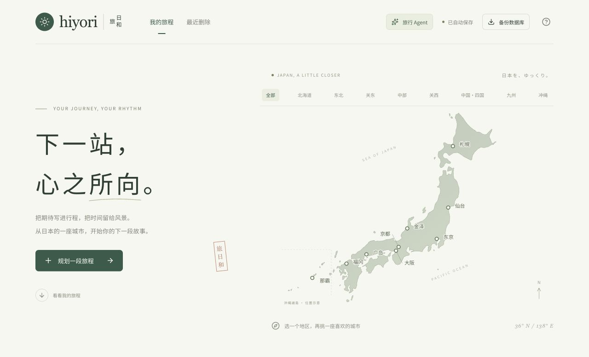

# 日和旅 · Hiyori Trip

> 把旅程排成喜欢的样子。

## 🌿 项目介绍

一款在自己电脑上运行的日本旅行规划网页，无需账号或 API Key。

- 🗾 从日本地图选择目的地，搜索景点、餐厅和车站，绑定准确位置。
- 🗓️ 按日期整理行程，支持跨天拖动、待规划和最近删除。
- 📍 玻璃行程浮层与地图联动，触控板双指开合缩放、同向滑动平移。
- 📄 按整趟或单日导出 PNG 长图、分页 PDF 或图片 ZIP，保存到系统下载目录。
- 💾 行程自动保存到本机 SQLite 数据库。
- ✨ 旅行 Agent：从攻略链接、文字、表格或图片生成可调整的行程草案，支持自定义 OpenAI 兼容模型。

## 🚀 快速部署

准备 **Node.js 24+** 和 npm，然后在终端运行：

```sh
git clone https://github.com/Charmstok/Hiyori-Trip.git
cd Hiyori-Trip
npm install
npm start
```

打开 [http://127.0.0.1:4317/](http://127.0.0.1:4317/)，保持终端运行；按 `Ctrl+C` 停止。开发模式使用 `npm run dev`。

行程保存在 `.local-data/hiyori.sqlite`，导出文件保存在系统下载目录（macOS 为 `~/Downloads`，Linux 优先使用 XDG 下载目录）。个人数据和导出文件均不会提交到仓库。

地图和地点搜索需要联网。地点选择弹窗在输入停顿后自动显示候选项；搜索只发送关键词和城市附近坐标。

点击右上角「旅行 Agent」，填写 `API Key`、`Base URL`、`model` 并保存即可，无需本机解锁密码。配置与最近草案加密保存在 `.local-data/agent.sqlite`，生成时材料会发送至你配置的模型服务。公开链接可能受登录限制，图片需要支持视觉的模型。详见 [Agent 使用与安全说明](docs/agent.md)。

## 🖼️ 界面展示



资源来源与许可见 [THIRD_PARTY_NOTICES.md](THIRD_PARTY_NOTICES.md)。
